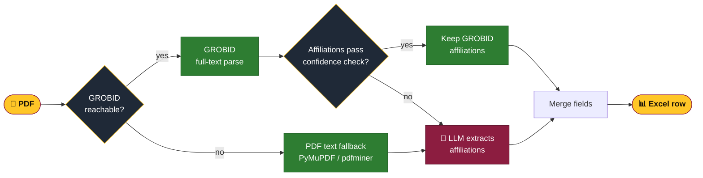

<div align="center">

# AlphaMind Extractor

### Efficient Extraction Pipeline for scholarly PDFs

Turn a folder of research papers into clean, structured metadata: titles, authors, author positions, affiliations, and abstracts. GROBID does the heavy lifting, and an LLM steps in only when GROBID is unsure.

[](https://articlyst.io)


</div>

> [!TIP]
> **Don't want to install anything?** Use **[Articlyst](https://articlyst.io)**, the web app built on this pipeline. Upload a folder of PDFs, and Articlyst extracts the metadata, clusters the papers by theme into an interactive dashboard, and lets your team label them together.

---

## Contents

- [What it extracts](#what-it-extracts)
- [How it works](#how-it-works)
- [Results](#results)
- [Quick start](#quick-start)
- [Command-line tools](#command-line-tools)
- [Use it from Python](#use-it-from-python)
- [Configuration](#configuration)
- [Confidence routing](#confidence-routing)
- [Evaluate against the gold standard](#evaluate-against-the-gold-standard)
- [Tests](#tests)
- [Project layout](#project-layout)
- [Used by Articlyst](#used-by-articlyst)

---

## What it extracts

Point it at a folder of PDFs and a list of target authors. It writes one Excel row per paper per target author:

| Column | Description |
|---|---|
| **Title** | Paper title |
| **Target Author** | The author you asked about |
| **Found Author Name** | How that author's name appears in the paper |
| **Author's Position** | First author, second author, and so on |
| **Total Authors** | Number of authors on the paper |
| **Affiliation** | The target author's institution |
| **Abstract** | Full abstract text |
| **File Path** / **Paper Row** | Where the result came from |

Names are matched robustly: initials (`B. Coley`), suffixes (`James Holly, Jr.`), and apostrophes (`Na'ilah`) all resolve to the right person.

---

## How it works



1. **GROBID first.** Every paper is parsed by [GROBID](https://github.com/kermitt2/grobid), which is fast, free, and very accurate on titles, authors, and abstracts.
2. **A rule-based confidence check.** Plain code (not an LLM) checks each affiliation GROBID found. See [Confidence routing](#confidence-routing).
3. **LLM only when needed.** If any affiliation looks doubtful, the paper's affiliations are re-extracted by an LLM (ASU CreateAI or OpenAI). Everything else stays GROBID's.
4. **Never stuck.** If GROBID is down, the pipeline falls back to the PDF's own text so every paper still produces a row.

### Four pipelines in one package

| Pipeline | Module | Approach | Needs |
|---|---|---|---|
| **AlphaMind Extractor** ⭐ | `alphamind_extractor.py` | GROBID + confidence-routed LLM | GROBID, LLM key |
| GROBID only | `grobid_pipeline.py` | GROBID for every field | GROBID |
| LLM only | `LLM_extraction_pipeline.py` | LLM reads the first pages | LLM key |
| NLP / ML | `NPL_extraction_pipeline.py` | spaCy named-entity rules | spaCy model |

---

## Results

> These results are from the ASEE paper evaluation on **50** peer-reviewed engineering education PDFs. Later runs on the codebase after **September 16, 2026** can differ; that is why some re-runs make AlphaMind and GROBID-only look closer overall even though the paper shows a clear gap.

Measured with `compare_pipelines.py` against the human-coded gold standard used in the ASEE paper (50 papers from venues including JEE, IEEE, and ACM).

### Overall (ASEE Table I + Table III)

| Pipeline | Macro F1 | Macro Prec. | Macro Rec. | Coverage | Time | LLM cost |
|---|:---:|:---:|:---:|:---:|:---:|:---:|
| **AlphaMind Extractor** ⭐ | **0.930** | 0.946 | 0.916 | 92.3% | 112 s | **$0.013** |
| GROBID only | 0.813 | 0.833 | 0.815 | 92.3% | 31 s | $0 |
| LLM only | 0.917 | 0.960 | 0.880 | 88.5% | 319 s | $0.045 |
| NLP / ML | 0.196 | 0.280 | 0.153 | 50.0% | 12 s | $0 |

AlphaMind beats GROBID-only on macro F1 (**0.930 vs 0.813**) mainly by fixing affiliations, and it beats LLM-only on cost and speed (**~2.8× faster**, about **30% of the LLM cost**) because the LLM is used only where needed.

### Per field (ASEE Table II, AlphaMind Extractor)

| Field | Precision | Recall | F1 |
|---|:---:|:---:|:---:|
| Title | 1.000 | 0.923 | 🟢 0.960 |
| Target Author | 1.000 | 0.923 | 🟢 0.960 |
| Found Author Name | 1.000 | 0.923 | 🟢 0.960 |
| Author's Position | 0.979 | 0.922 | 🟢 0.950 |
| Total Authors | 0.917 | 0.917 | 🟢 0.917 |
| Affiliation | 0.812 | 0.907 | 🟢 0.857 |
| Abstract | 0.915 | 0.896 | 🟢 0.905 |

For comparison, GROBID-only affiliation F1 in the same evaluation was **0.038**. That is the failure mode AlphaMind is built to fix.

---

## Quick start

> [!IMPORTANT]
> Use a project-local virtual environment. Don't install into Anaconda `base` or any shared environment.

**1. Install**

```bash
python3 -m venv .venv
source .venv/bin/activate
python -m pip install -U pip
python -m pip install -e ".[dev]"
```

**2. Start GROBID** (needs Docker)

```bash
docker run --rm --init --ulimit core=0 -p 8070:8070 grobid/grobid:0.9.1-full
```

Use the **full** image. It includes the deep-learning header and affiliation models; the smaller CRF image is weaker on author lists.

**3. Add your LLM key**

```bash
cp .env.example .env
# then set ASU_CREATE_AI_KEY=...  (or LLM_PROVIDER=openai and OPENAI_API_KEY=...)
```

**4. Check everything is reachable**

```bash
extraction-preflight
```

**5. Run**

```bash
alphamind-extract path/to/papers "Brooke Coley, Monica Cox"
```

Results are written to `data/evaluation/alphamind_extractor_results.xlsx`.

---

## Command-line tools

Installing the package adds these commands:

| Command | What it does |
|---|---|
| `alphamind-extract [papers_dir] [authors]` | Run the hybrid AlphaMind Extractor |
| `grobid-extract [papers_dir]` | Run the GROBID-only pipeline |
| `compare-pipelines` | Score pipeline outputs against the gold standard |
| `extraction-preflight` | Check GROBID and the LLM gateway before a long run |

`authors` is a comma-separated list. Leave it out to use the built-in target-author list. Add `--no-consolidate-header` to skip CrossRef / biblio-glutton header enrichment and use PDF-only metadata.

---

## Use it from Python

Install straight from GitHub into any project:

```bash
python -m pip install "git+https://github.com/Joshua-123-ansah/efficient-extraction-pipeline.git@main"
```

```python
from pathlib import Path
import alphamind_extractor as am

grobid_ok = am.is_grobid_alive()
metadata, llm_metadata = am.extract_hybrid(Path("paper.pdf"), grobid_ok)

print(metadata["title"])
print(metadata["affiliation_source"])  # "grobid" when the LLM was skipped
```

To pick up the latest version later:

```bash
python -m pip install --upgrade --force-reinstall --no-deps \
  "git+https://github.com/Joshua-123-ansah/efficient-extraction-pipeline.git@main"
```

---

## Configuration

All settings are environment variables. Put them in `.env` (see [`.env.example`](.env.example)).

| Variable | Default | Purpose |
|---|---|---|
| `GROBID_URL` | `http://localhost:8070` | Where GROBID is running |
| `GROBID_SERVICE` | `processFulltextDocument` | GROBID endpoint |
| `CONSOLIDATE_HEADER` | `1` | `0` = PDF-only headers, no CrossRef lookup |
| `LLM_PROVIDER` | `createai` | `createai` (ASU) or `openai` |
| `ASU_CREATE_AI_KEY` | — | CreateAI token (`CREATEAI_API_KEY` also works) |
| `OPENAI_API_KEY` | — | Used when `LLM_PROVIDER=openai` |
| `OPENAI_MODEL` | `gpt-4o-mini` | Model for affiliation extraction |
| `ROUTE_ON_GROBID_CONFIDENCE` | `1` | `0` = call the LLM on every paper |
| `ROOT_PAPERS_DIR` | `data/corpora/my_papers` | Default input folder |
| `OUTPUT_XLSX` | `data/evaluation/…` | Where results are written |
| `MAX_WORKERS` | `2` | Papers processed at once |

---

## Confidence routing

The decision to call the LLM is made by plain code, not by the LLM. A paper skips the LLM only if GROBID found at least one affiliation and **every** affiliation passes all of these checks:

| Check | Rule | Setting |
|---|---|---|
| ✅ Not empty | Has text, and isn't "not specified" or "nan" | — |
| 📏 Sensible length | 12–300 characters | `GATE_MIN_CHARS`, `GATE_MAX_CHARS` |
| 1️⃣ One affiliation | No `;` joining several affiliations together | `GATE_MAX_SEGMENTS` |
| 🔁 Not repeated | Not "Purdue University Purdue University" | — |
| 🏛️ Names an institution | Contains university, college, institute of technology, polytechnic, academy, or school | — |

If any single affiliation fails, the whole paper goes to the LLM.

Measured on the gold set, this check sends **~20%** of papers to the LLM, and when it trusts GROBID it is right **94.6%** of the time (35 of 37).

---

## Evaluate against the gold standard

```bash
# Score the existing result files in data/evaluation/
compare-pipelines

# Re-run GROBID first, then score
compare-pipelines --run --run-which grobid

# PDF-only headers (no CrossRef enrichment)
compare-pipelines --run --run-which grobid --no-consolidate-header
```

The LLM pipelines cost money, so they only run with `--llm-ok`. The summary is written to `data/evaluation/pipeline_evaluation_summary.xlsx`.

---

## Tests

```bash
python -m pytest tests/ -q
```

No network needed: GROBID and the LLM gateway are stubbed. The suite covers ~84% of statements and pins eleven real bugs found and fixed in this codebase. See [`tests/README.md`](tests/README.md) for details.

---

## Project layout

```text
alphamind_extractor.py      ⭐ Hybrid GROBID + confidence-routed LLM pipeline
grobid_pipeline.py          GROBID-only pipeline
LLM_extraction_pipeline.py  LLM-only pipeline
NPL_extraction_pipeline.py  spaCy NLP pipeline
compare_pipelines.py        Scoring against the gold standard
preflight_check.py          Connectivity checks for GROBID and the LLM gateway
pipeline_paths.py           Default data / output paths
data/gold/                  Gold-standard labels
data/corpora/my_papers/     Put your PDFs here (not committed)
data/evaluation/            Result spreadsheets (not committed)
tests/                      pytest suite
```

---

## Used by Articlyst

<div align="center">

[](https://articlyst.io)

</div>

**[Articlyst](https://articlyst.io)** is a web platform for lab teams that runs this pipeline behind the scenes:

- 📤 Upload a folder of PDFs, or a ZIP
- 🧠 Metadata extracted with AlphaMind Extractor
- 🗺️ Interactive clustering dashboards that group papers by theme
- 👥 Blind team labelling, agreement and disagreement views, and summary statistics

Articlyst installs this package straight from GitHub, so improvements pushed here reach the live site on its next rebuild.

---

<div align="center">

Built by **Joshua Owusu Ansah**

</div>
